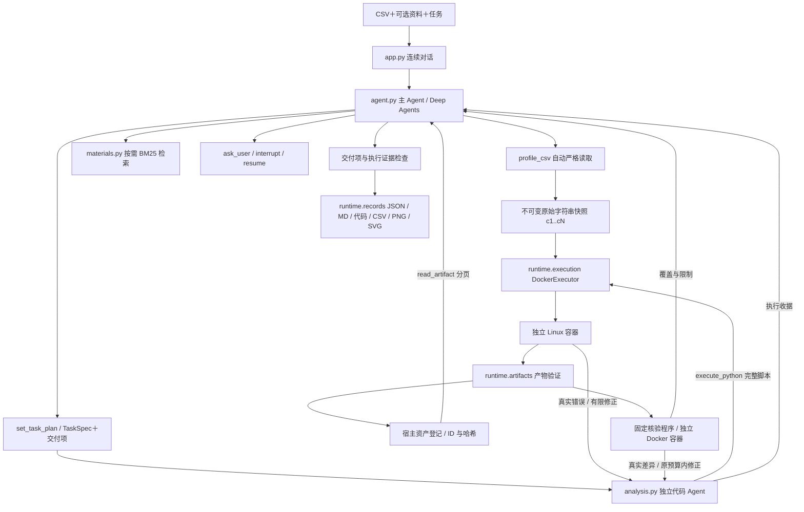

# Agent 核心与应用架构

保留 D5 的双 Agent 分析核心。浏览器应用在其外侧增加 FastAPI、SQLite、受管理文件、SSE 和受控工作进程；不会通过 CLI 输出解析调用 Agent，也不会增加宿主代码执行路径。版本 3 的任务约定与独立核验见[可靠分析](reliability.md)；应用层边界、状态机、数据模型及安全设计见 [Desktop 设计](desktop.md)。

## 主要模块

| 模块 | 主要职责 |
|---|---|
| `app.py`、`cli.py` | VS Code 对话入口与保留的 CLI；收集输入、显示流式进度和结果；CLI 提供本地应用启动 |
| `web/`、`frontend/` | 本地应用服务、受控工作进程、基础历史与文件关联；React 真实聊天界面 |
| `web/conversations.py`、`web/migrations/003.sql` | 重命名、持久化置顶、独占文件永久清理与可重试删除日志 |
| `web/deadlines.py` | 基于单调时钟的模型/任务时限，人工等待暂停，事件不会重置期限 |
| `config.py`、`run_config.py` | 模型凭证与运行设置分开读取；不把凭证写入记录 |
| `agent.py` | `AgentSession`、`create_session()`、`run_intake()`；主图、计划、委派、RAG、澄清与完成校验 |
| `analysis.py` | `AnalysisRunner.delegate()`；独立 `create_agent` 上下文，完整脚本执行与有限修正 |
| `contracts.py`、`modeling.py` | 类型化任务约定、源列/交付绑定和建模成果格式；不提供业务算法模板 |
| `runtime/verification.py`、`runtime/verification_program.py` | 宿主选择核验程序、独立容器内复算样本身份/拆分/指标，返回具体证据和未覆盖项 |
| `tools/csv_profile.py` | `load_csv_snapshot()` 严格自动识别和不可变快照；`profile_csv()` 通用概览 |
| `materials.py` | `build_material_index()`、本地解析/切分/BM25；首次检索时才读资料 |
| `runtime/harness.py` | `ExecutionHarness` 过滤实际工具集，校验调用 ID、预算、去重与账本 |
| `runtime/evidence.py` | 消息轨迹、末尾 JSON 协议解析和检索引用来源校验 |
| `runtime/execution.py` | `DockerExecutor.preflight/execute/cancel`；新容器、输入暂存、超时/OOM/取消、清理 |
| `runtime/artifacts.py` | `validate_payload()`、`artifact_view()`；文件类型/大小/SVG/哈希与分页 |
| `runtime/records.py` | `save_run()` 排他写入、保存失败回滚、报告和全部产物 |
| `runtime/replay.py` | `replay_analysis()` 验证输入/代码哈希，在原镜像内重放，不调用模型 |
| `runtime/streaming.py` | `stream_execution()`、`ConsoleStream`；公开回答增量与执行进度，子模型正文不显示 |
| `offline.py` | 两个确定性演示模型；测试无需模型网络，计算仍用 Docker |
| `sandbox/` | Docker 构建文件、带哈希依赖锁、容器监督程序与输入/输出 helper |

`create_deep_agent`、`create_agent`、中间件接口、`InMemorySaver`、`interrupt/Command` 来自 LangChain/LangGraph/Deep Agents。数据快照、预算账本、交付协议、Docker 执行器、校验/导出及业务入口由本项目编写。框架默认文件工具与通用委派工具被隐藏并拒绝执行。

计划输入允许首次提交及最多两次修正，总共三次计划调用，仍占主模型最多12次的总预算；反馈只包含项目定义的校验消息、错误位置/类型，不转发含输入值的原始SDK异常。有效计划仍会冻结，不能借重试改变要求。工具越权、调用 ID 篡改及预算超限仍拒绝执行。后续绘图委派的核验可读取本任务已完成的建模成果；新任务清空委派账本，历史成果不计入当前完成证据。主 Agent 收到真实核验摘要，子 Agent 的文字不能替代它。

## 执行协议与 Harness

原始数据以字符串 JSON 快照进入容器；重复表头使用不同 `cN`，原名在列映射中，前导零、NA、NULL 不自动改变。每次脚本重新 `load_dataset()`，没有隐藏 Notebook 变量。`emit_table()`、`emit_metric()`、`emit_figure()` 只导出，不实现统计业务算法。

列映射 `df.attrs["columns"]` 是包含 `id/position/name` 的字典列表；脚本使用稳定 `cN` 选择列。table/metric/figure 交付项分别使用对应 emit 函数；独立 explanation 交付项使用 `emit_metric()` 保存支撑事实，普通口径说明只放入最终回答。产物校验错误返回具体原因，代码 Agent 可以按真实错误修正。

生成脚本是容器中独立子进程。父监督程序捕获其 stdout/stderr，扫描临时区中的普通文件，返回有界 JSON/base64 协议。宿主拒绝路径穿越、符号链接、类型/行数不匹配、非有限 JSON、主动脚本与外链 SVG，并计算自己的 ID/哈希。输出总计 50 MiB、每任务最多两图；模型只收到摘要和分页。临时区通过协议在容器退出前读取，停止后移除容器。

容器使用不可变镜像 ID、非 root、无网络、只读根、cap-drop、no-new-privileges、64 PID、2 CPU/1 GiB、128 MiB tmpfs。只挂载当前任务暂存的快照与脚本，不挂载项目、用户目录、源 CSV 或 Docker socket。按 Docker CLI 优先级检查 context/host，只接受本地 Unix/named-pipe endpoint；执行与清理固定使用已校验端点。显式清空代理变量，防止 Docker 客户端配置自动传入代理凭证。

每任务主/代码模型各最多 12 次，委派两次，每委派执行三次，检索三次、澄清三次。相同调用 ID 相同参数只执行一次；重用 ID 改参数拒绝；恢复不中途重置预算。后续新任务预算重置，上下文保留，范围变化需重新执行。

主 Agent 将原始任务与确认回复转交给代码 Agent，委派摘要不替代任务约束。JSON/CSV/图表类型分别对应 metric/table/figure。截断响应或不完整工具参数在执行前拦截，至多一次格式修正并占用原调用预算；诊断只记录安全元数据。真实代码退出成功但缺少 emit 产物时，工具明确返回缺失交付项，允许完整脚本修正。

修正的合法产物原子替换本任务、本授权委派的暂存成果；失败保留原部分成果。后续授权委派可接管同范围未完成成果，但不能抵扣其他交付项、已完成委派或历史任务的配额。最终界面与重放仅使用当前成果，所有真实代码尝试继续保留；因此两张暂存图不会阻止完整修正再次绘图。Markdown 报告可展开 report_markdown 说明内容，禁用其主动 HTML/远程图片，超大指标仅显示有界预览，完整 JSON 仍导出。

主 Agent 登记计划后未取得所需执行成果就结束，或取得成果后最终回答格式不合法时，宿主分别最多提供一次执行补全反馈和一次格式反馈，合计不超过两次，继续同一图与任务。两类反馈共享原模型/工具预算；格式修正不重新计算已有成果。报告记录 `completion_feedback`。模型在合法末尾 JSON 前添加正文或代码围栏时可解析唯一的协议对象；正文不作为答案或证据，多个协议对象、尾随正文、重复键及非有限值拒绝。解析后仍校验字段、真实执行、产物 ID 和必需交付项；代码子任务保留 `final_response` 供诊断。

计算产物必须对应计划中的交付项且来自实际成功执行；子 Agent 返回的 ID 要与宿主登记一致。显式图表要求还需真实 figure 产物。纯概览或字段解释可以根据实际概览/检索结果直接交付报告；若记录了 explanation 交付项，answer_deliverables 将其绑定到 final_answer 和输入来源，不伪造代码执行。表格、指标、图表及计算解释不能用正文替代。缺少交付项返回 error，并保存合法的部分成果。校验不证明代码的统计口径必然正确，也不证明每句话都被引用支持。

新报告版本为 3，保存任务约定、独立核验及实际用量；版本 2 历史仍可查看和重放，缺少新核验信息时显示未核验。旧 JSON 不转换成可恢复会话，内存检查点仅在当前进程有效。成功脚本重放需要相同输入哈希和本地原镜像 ID；版本 3 还会重新执行适用的独立数值检查，但不调用模型或证明所有结论正确。

应用运行 ID 与核心会话/任务 ID 分开。应用在核心证据通过、成果写入和 SQLite 登记都完成后才发布 completed；历史记录恢复不恢复执行检查点。服务重启后未完成任务标记 interrupted，后续任务使用新的 Agent 运行时和核验后的历史背景。
