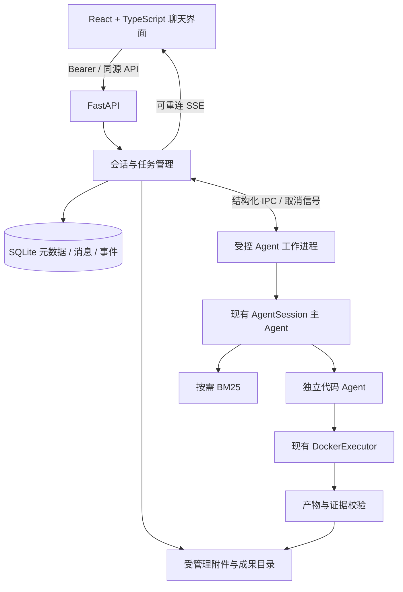
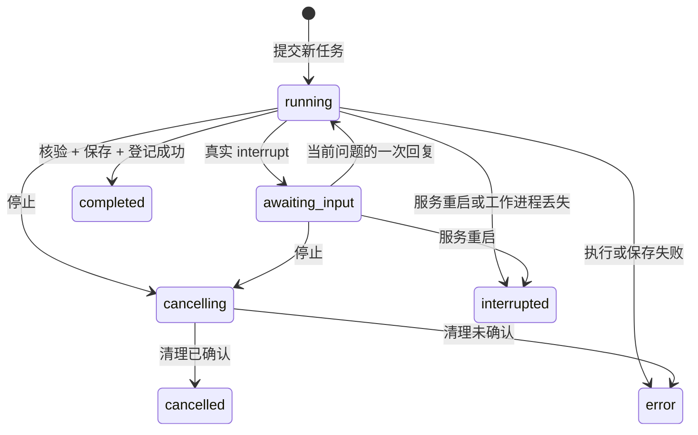

# Analyvia Desktop：P0 设计与 P1 实施说明

本轮在现有 D5 代码上增加浏览器应用，不重写 Agent。设计基线为 `982c401`。P1 包含基础聊天历史；搜索、完整文件管理、独立知识库和 Tauri 安装包按 P2–P4 推进。本文说明应用边界，实际验收结果集中记录在 [验收](verification.md)。

## 1. 现有代码审计

| 模块 | 已有能力 | 应用化边界 |
|---|---|---|
| `agent.py` | `create_session()`、`invoke/resume/cancel/save`；Deep Agents 主图、澄清、计划、委派、完成校验 | 服务直接调用公开接口，不解析 CLI 输出；只补充上下文、取消和事件兼容接口 |
| `analysis.py` | 独立 `create_agent`；`execute_python` 和授权的 `read_artifact`；真实报错修正 | 子模型正文不当作公开回答；展示实际传给执行器的代码和返回的执行收据 |
| `tools/csv_profile.py` | 编码/分隔符自动识别、严格解析、不可变字符串快照 | 一个对话绑定一份 CSV；重复表头、前导零及 NA/NULL 文本保留 |
| `materials.py` | TXT/MD/文字型 PDF、延迟建立 BM25、片段出处与哈希 | P1 资料属于当前对话；提供资料不强制检索，不宣称已有持久知识库 |
| `runtime/harness.py`、`evidence.py` | 工具授权、预算、调用 ID 去重、实际账本、引用和交付证据校验 | 历史产物仅作背景，不能完成新运行的交付项 |
| `runtime/execution.py` | 新容器执行、资源限制、固定本地 Docker 端点、取消与清理 | 增加宿主设置的归属标签；监督进程只能清理本应用本运行的容器 |
| `runtime/artifacts.py`、`records.py` | 产物协议、文件/哈希校验、全量 CSV、PNG/SVG、排他保存与失败回滚 | 服务协调文件保存和 SQLite 登记；两者成功后才发布完成状态 |
| `runtime/streaming.py` | 主回答增量、工具和执行阶段 | 增加结构化执行/RAG/中断事件；不暴露内部推理或原始 SDK 异常 |
| `app.py`、`cli.py` | VS Code 当前进程内对话、配置驱动 CLI | 原入口保留；新增 `labweaver serve --open` |

当前检查点来自 LangGraph `InMemorySaver`，仅在工作进程存活时有效。`resume()` 延续同一任务预算；新任务重置预算。失败或取消后需创建新的运行时。JSON 导出不是检查点，也不提供跨进程中断恢复。

核心任务预算保持不变：主模型 12 次、代码模型合计 12 次、委派 2 次，每次委派最多 3 次 Python 尝试；检索 3 次、澄清 3 次、最多两张图。相同调用 ID 不重复执行，恢复不重置预算。

CSV 限制为 10 MiB、10 万行、200 列、单字段 64 KiB。资料最多 10 份、单份 5 MiB、总计 20 MiB、单 PDF 100 页；扫描件、加密 PDF、无法解析及超限明确失败。完整结果不增加 100 行上限，模型和界面仅分页预览。容器产物总计最多 50 MiB。

## 2. 增量架构与技术取舍

- `src/labweaver/web/` 管理 API、任务监督、IPC、SQLite、受管理文件和历史重建；不实现第二套分析算法。React 源码位于 `frontend/`。
- FastAPI 是可选 `web` 依赖，使用其原生 SSE；CLI 不需要安装前端依赖。[FastAPI SSE](https://fastapi.tiangolo.com/tutorial/server-sent-events/)
- 使用标准库 `sqlite3`、版本化 SQL 迁移、外键、短事务和 WAL。数据库位于本地磁盘，不放网络共享目录。不增加 ORM、Redis 或 Celery。[SQLite WAL](https://www.sqlite.org/wal.html)
- 安装阶段构建前端，生产服务同时提供静态界面和 API；日常启动无需 Vite。开发时 Vite 明确代理到回环 API。没有新增浏览器端计算图表库，图表来自真实 Docker 产物。
- 默认数据目录位于用户的应用数据目录；附件、成果、SQLite、缓存归属该目录。工作进程在可写应用目录运行，项目配置和选中输入先解析为绝对路径，避免依赖安装位置和 jieba 缓存权限。
- Windows Store 等打包宿主可能把名义 AppData 路径重定向到 Packages 的 LocalCache。受管理数据目录与容器输入临时目录创建后解析为真实规范路径；Store、工作进程和成果登记统一使用同一根目录，Docker 挂载也使用实际存在的目录。路径归一化不取消归属校验，也不放宽只读输入挂载。
- 全局仅缓存一个当前对话的受控工作进程。当前对话完成后可复用该运行时；切换对话、显式选择历史、失败、取消或重启后重建。只有一个全局活动任务，包括等待回复。P1 不增加排队或并行执行；浏览历史不受分析运行阻塞。
- P4 使用 Tauri 2 和 Python sidecar，复用此服务与前端，不把 Python 核心迁移到 Rust。[Tauri sidecar](https://v2.tauri.app/develop/sidecar/)

### 新增模块与修改职责

| 文件或目录 | 本轮职责 |
|---|---|
| `web/settings.py`、`server.py` | 后端配置、应用数据目录、回环启动、构建前端检查及浏览器令牌引导 |
| `web/api.py` | 类型化 API、Host/Origin/Bearer 保护、上传限额、SSE 重连及授权预览/下载 |
| `web/manager.py` | 全局活动任务、进程监督、幂等回复、取消、文件/数据库登记、启动恢复 |
| `web/worker.py` | 在受控进程直接调用 AgentSession，传递公开事件并保存实际报告；不在宿主执行生成代码 |
| `web/store.py`、`web/migrations/001.sql` | SQLite 基础历史、关联、事件序号、短事务和版本化结构 |
| `web/files.py`、`web/security.py` | 受管理导入、严格预览、哈希、路径/归属边界、敏感配置过滤 |
| `web/context.py` | 对话内最近两次或明确选定任务的可核验事实重建，32 KiB 预算 |
| `frontend/src/` | 三栏聊天界面、统一授权客户端、流式状态、澄清、实际表格/图表与下载 |
| `frontend/e2e/`、前端测试配置 | 浏览器交互、恢复及三类真实 Docker 分析；单元测试与生产构建 |
| `agent.py`、`analysis.py`、`runtime/streaming.py`、`runtime/execution.py` | 兼容历史背景、取消信号、真实结构化事件、运行归属标签；保留原分析和证据逻辑 |
| `cli.py`、`pyproject.toml`、`uv.lock` | 可选 `web` 依赖与 `serve` 命令，保留 intake |
| `start-analyvia.cmd` | 一个正式 Windows 启动器；正常运行不隐式安装依赖或构建镜像 |
| `tests/test_web_*.py`、CI | 存储/权限/监督/API、真实容器与在线验收；CI 不配置模型密钥 |

前端依赖锁文件与后端锁文件均发布。安装缓存、构建目录、数据库、个人文件及测试产物不发布；公开源码和标准测试集中管理。

## 3. 界面与交互

三栏布局采用中文、系统字体和系统明暗主题。左侧是新建与历史列表；中间是附件、对话、澄清和成果；右侧执行面板默认折叠，显示计划、主/代码 Agent、真实 Python、错误、文件和检索出处。窄屏折叠导航与执行面板，表格允许横向滚动。

2026-10-12 调整了常用文字和图标尺寸。聊天区直接展示由真实服务事件汇总的执行过程，包括工具调用、Python 执行与修正、检索、核验和成果保存；较早步骤可折叠查看。右侧继续保留完整执行细节。步骤成功只表示对应工具或执行成功，最终完成仍以核验、保存和数据库登记后的终态为准。

P1 不提供工作空间、独立知识库或搜索空页面。设置已可配置服务商与模型，对话可重命名、置顶或明确确认后永久删除。常用操作在当前对话完成，复杂执行细节在右侧查看。输入框支持 Shift+Enter 换行和输入法组合态保护；Enter 不应提交尚未完成的中文输入。

1. 新建对话，选择、拖入或粘贴浏览器实际提供的 `File`；一个 CSV 加可选 TXT/MD/PDF。新建时优先复用没有附件、消息和任务的空草稿，连续点击不堆积空对话；已有输入或历史的对话不作为空草稿复用。上传后展示文件名、类型、大小和解析预览；解析失败不会伪装为可用资料。
2. 首次发送之前允许移除或替换附件；首次任务发送后冻结输入。不同 CSV 或资料需新建对话，避免历史结果与新输入混淆。
3. 发送自然语言任务后显示真实执行阶段；正文增量标记待核验，工具成功不等于任务完成。
4. `awaiting_input` 时展示实际问题与结构化格式候选；回复绑定问题 ID。普通关键歧义继续由主 Agent 决定。
5. 任务结束展示核验后的回答、分页表格、指标、真实 PNG；CSV、SVG、代码和报告按登记文件下载。
6. 停止先进入 `cancelling`；确认工作进程与所属容器清理后才显示 `cancelled`。合法部分成果保留，不宣称已完成所有交付。
7. 刷新只重连事件，不重新执行任务。重启后可查看历史并发起新任务；中断任务提供按原任务重新执行，不调用失效的 `resume()`。

Windows 资源管理器的文件复制不一定会转换成浏览器 `File`。P1 不读取粘贴的路径字符串，也不宣称支持图片分析；兼容失败引导选择文件或拖拽。[浏览器文件接口](https://developer.mozilla.org/en-US/docs/Web/API/DataTransfer/files)

## 4. 会话、历史与执行状态

每次新任务有应用 `run_id`，与核心 `session_id/task_id` 分开登记。任务和澄清回复带请求幂等 ID；问题有独立 `question_id`。重复提交返回原结果，不重复恢复节点或扣预算；旧问题、错误状态和别的运行的回复拒绝。

同一活进程使用现有 Session 保留上下文。重启、错误或取消后，新建 Session 并重建最近两次已完成任务的背景；用户可显式选择历史任务。背景包括目标、确认口径、核验回答、指标、表格预览和成功完整脚本。先核验输入及引用产物哈希，背景总量最多 32 KiB；完整代码超限则省略并注明，不截断为无效 Python。

背景不是权限指令，也不是新任务的执行证据。新计算使用原始快照并取得本轮真实成果。启动时把遗留非终态运行标记为 `interrupted`，保留可核验的部分成果，不自动恢复节点，不自动执行旧任务，不导入个人 CLI 日志。

工作进程的临时目录使用宿主生成的 `runtime/<conversation_id>/<runtime_id>`，不使用可重复的PID归属。进程退出或强制停止后由宿主验证路径并清理；清理未确认不能报告取消成功。服务崩溃留下的该对话目录也纳入永久删除的隔离日志。旧版本PID目录无法可靠关联对话，不能猜测归属并自动删除；这部分遗留缓存的显式管理留待P2。

工作进程用结构化消息传递请求、公开事件、报告和保存结果；不序列化模型对象或检查点。API 进程负责授权、幂等与登记，模型密钥只在后端配置读取。停止设置共享信号并阻止新模型/工具调用，立即尝试取消容器。宽限期为 5 秒，随后终止本应用拥有的进程树并核对标签匹配的 Docker 容器。不能删除其他容器；清理无法确认必须返回明确错误。

### 本地服务生命周期

关闭网页不等于结束服务。`server.py` 先独占绑定回环 socket，再将该 socket 交给 Uvicorn；只有真正完成 startup 后才打开浏览器。端口无法占用时不会初始化另一个任务管理器、恢复历史或打开带错误令牌的页面。

`instances.py` 提供同项目的实例发现。默认启动使用稳定的用户目录 `~/.labweaver/instances/`，避免 Windows 打包宿主与普通启动器的 AppData 视图不同。保留不含令牌的默认数据根绑定，退出后仍沿用原历史；显式 `--data-dir` 完全隔离。Windows 运行记录由当前用户 DPAPI 保护，Unix 使用0700目录/0600文件。实例发布与按代清理共享短文件锁，旧进程不能删掉新实例；冷启动有界等待，不无限阻塞。

启动器先发送随机 nonce 和用途为 launcher 的 HMAC 身份证明，API 返回用途为 server 的证明。签名绑定协议版本、项目、实例、端口、模式与 nonce；身份路由仍校验 Host/Origin。未验证前不向已占端口发送 Bearer，不信任可能复用的 PID，不跟随重定向或使用代理。只在证明匹配且模式一致时，重新打开带原应用令牌的启动链接；将令牌 URL 编码以保留特殊字符。

`POST /api/v1/application/shutdown` 需要正常应用认证，仅在没有活动任务时接受。检查活动状态和禁止新任务在同一管理器锁内完成，响应后触发 Uvicorn 优雅退出，lifespan 关闭工作进程并释放锁与端口。正在退出的服务不提供有效复用证明。前端收到202后清除本次应用令牌、停止事件读取和轮询，并显示退出页。刷新/关闭标签页不自动退出，避免中断分析。

## 5. SQLite 数据模型

迁移用 `PRAGMA user_version` 版本化，启用外键和 WAL。主键使用服务生成的不透明字符串 ID；时间以 UTC 保存。数据库保存元数据，图片和完整 CSV 存磁盘。

| 表 | 主要字段与关联 | 必需约束 |
|---|---|---|
| `conversations` | ID、标题、创建/更新时间、输入冻结状态 | 不允许冻结后变更附件绑定 |
| `messages` | ID、conversation/run、role、正文、question/reply、核验状态 | 对话/任务外键；生成文本与核验回答分开 |
| `runs` | ID、conversation、任务、request_id、核心 ID、状态、报告、统计/错误 | 每对话 request_id 唯一；终态与报告关联 |
| `files` | ID、显示名称、受管理相对路径、类型、大小、SHA-256 | 存储路径不由客户端指定；大小/类型校验 |
| `conversation_files` | conversation/file、CSV 或资料角色、资料顺序 | 一个 CSV；无重复绑定；资料次序稳定 |
| `executions` | run、委派/尝试、代码文件、退出码、耗时、错误、镜像 ID | 真实执行 ID 唯一；仅登记本轮执行 |
| `artifacts` | run、核心产物 ID、种类、标签、来源、预览/口径 | 归属与源哈希校验；不能用历史 ID 完成本轮交付 |
| `artifact_files` | artifact、文件 ID、用途、实际大小/SHA-256 | 文件协议白名单与归属约束 |
| `run_events` | run、递增 seq、type、role、UTC 时间、JSON payload | `(run_id, seq)` 唯一；事件严格 JSON |
| `conversation_models` | 对话最近一次实际选择的服务商/模型公共快照 | 对话外键；不保存 Key |
| `run_models` | 每运行的实际服务商、模型、Base URL 公共快照 | 运行外键；历史选择不随设置编辑变化 |

文件系统与 SQLite 不构成共同事务：先由现有 `save()` 排他写入并校验，再短事务登记执行、文件、产物、最终消息和终态。任一步失败不发送 `completed`。启动检查中断记录与其目录；可验证的部分文件保留，未登记文件不能通过下载 API 访问。后续 P2 增加清理和引用计数，不用静默删除历史来解决容量问题。

## 6. API 与事件协议

所有 API 使用 `/api/v1`；下表是稳定的功能契约，具体响应类型由服务实现并作为测试契约。提交分析返回 `202`，请求本身不阻塞模型执行。

| 方法与路径 | 请求/响应职责 |
|---|---|
| `GET /health` | 受保护的配置、数据目录、Docker/镜像状态；不返回密钥 |
| `POST /conversations`、`GET /conversations` | 创建、列出基础历史 |
| `GET /conversations/{id}` | 消息、冻结附件、任务和成果快照 |
| `POST /conversations/{id}/files` | multipart 单文件上传；累积限制与类型校验 |
| `DELETE /conversations/{id}/files/{file_id}` | 首次发送前移除当前对话附件 |
| `POST /conversations/{id}/runs` | task、request_id、可选历史任务 ID |
| `GET /runs/{id}` | 当前状态与成果快照 |
| `GET /runs/{id}/events` | 授权 SSE；从 after/Last-Event-ID 补取 |
| `POST /runs/{id}/reply` | reply、question_id、request_id |
| `POST /runs/{id}/cancel` | 幂等停止 |
| 已登记成果的预览/下载接口 | 不透明文件或产物 ID；表格分页与完整文件分离 |

公开事件封装包含 `version`、`conversation_id`、`run_id`、`seq`、`type`、`time` 和 `payload`。类型覆盖计划、模型请求开始/结束/格式修正、工具开始/结束、代码执行开始/结束、检索片段、正文增量、澄清、保存和终态。模型事件只传角色、调用序号、安全结束原因和耗时；不显示推理或生成中的代码。执行开始公开真正传给工具的 Python；结束公开真实退出码、耗时、有界 stdout/stderr、错误和产物收据。delivery_status 区分进程运行成功与成果交付齐全。

应用工作进程由 model_timeout/task_timeout 监督，默认 180/900 秒，人工澄清期间暂停累计时限；停止并只清理当前运行的容器。时限按宿主接收真实模型事件计时，极端文件/数据库阻塞可能造成边界偏差；不是模型服务器端精确计时承诺。

SSE 先持久化再发送。连接中断不会取消或重跑，重连从已知序号补取并去重；终态后流结束。前端统一使用可附加 Bearer 的请求客户端，而非把令牌写进 EventSource URL。临时正文不是完成证据，终态来自服务协调后的登记结果。

## 7. 权限与安全边界

- 仅监听 `127.0.0.1`。启动生成独立应用令牌，通过启动 URL 的 fragment 交给页面后立即清除；不用查询参数传令牌，不记录认证头。应用令牌与模型 API Key 不同。
- API、SSE、图片与下载全部验证应用令牌、Host/Origin；生产同源，开发只允许明确的回环地址，没有通配 CORS。静态页可打开但没有令牌不能访问数据。
- 文件 ID 查找必须确认归属，最终路径必须位于应用受管理目录。拒绝任意本地路径、目录遍历、符号链接和 Windows 重解析点逃逸。源文件复制导入后保持只读，不把宿主原文件直接交给容器。
- Markdown 不执行 HTML；Python/错误/资料以文本显示，PNG 来自本轮合法登记。SVG 下载前沿用主动脚本及外链检查，不加载远程图表资源。
- 后端只暴露安全配置状态。原始 SDK 异常、完整认证头和凭证不进入事件、SQLite、报告或前端；密钥哨兵测试覆盖所有公开/持久化通道。
- 生成代码仍仅在现有无网络、非 root、只读根、cap-drop、2 CPU/1 GiB、128 MiB 工作区 Docker 内执行。API 工作进程只编排 Agent，不提供宿主 Python 执行降级。
- 私人 CSV、资料、运行记录、数据库、API 配置、生成代码和图片不进入 Git；CI 仅用公开合成数据和确定性模型，计算必须实际在 Docker 中执行。

### 服务商与模型设置

桌面输入框右下角提供模型选择器，左侧设置入口提供服务商配置。`web/providers.py` 管理公共配置和运行解析，`credentials.py` 管理后端凭据，`provider_http.py` 只处理用户主动发起的模型列表/连接探测。公共服务商配置保存在既有 `app_meta` 的版本化 JSON 中；SQLite 迁移 002 增加对话和运行的选择快照，保留版本 1 的历史数据。凭据不放入数据库。

默认预置 DeepSeek，兼容自定义 OpenAI Chat Completions 接口。官方 DeepSeek 既有配置通过环境引用使用；其他既有接口保留独立只读环境项。地址验证拒绝 userinfo、查询参数、片段和控制字符；HTTP 探测不跟随重定向、限制响应大小和等待时间，不返回原始服务商错误。刷新网络请求不持任务管理全局锁，写回前重新检查活动任务与配置修订号。

新 Key 为只写字段，公开接口仅返回是否配置和保存方式。Windows 使用当前用户 DPAPI 保护的独立文件，非 Windows 暂为后端会话内存；不保存明文或 Key 哈希。空 Key 保留已有凭据，显式清除才删除；公开字段禁止包含应用令牌或模型 Key，防泄漏检查递归检查原始字符串，避免 JSON 转义绕过。

任务提交可携带 `provider_id/model_id`。Manager 在创建工作进程前解析真实 `ModelConfig`，两个 Agent 都通过这个配置创建模型；应用设置、密钥修订或模型变化时，在下一任务重新建 Runtime 并重建已核验的有限历史。运行中和等待澄清时锁定模型选择及配置编辑，恢复节点沿用原任务模型。模型 ID、地址和 Key 不由 Agent 工具改变，模型凭据不进入 Docker。旧 API 客户端省略选择仍可沿用现有后端配置。

| 设置接口（均需应用认证） | 职责 |
|---|---|
| `GET /settings/providers` | 公共配置、默认选择与凭据保存方式 |
| `POST /settings/providers`、`PUT /settings/providers/{id}` | 新建/编辑服务商；Key 只写 |
| `POST /settings/providers/default` | 设置应用默认服务商与模型 |
| `POST /settings/providers/{id}/models/refresh` | 显式从已保存接口获取模型列表 |
| `POST /settings/providers/{id}/test` | 小规模真实连接与工具调用测试 |

任务、对话和运行事件包含公共 `model_selection`；原 CLI JSON 报告格式继续保留。设置删除/并发模型/独立角色模型配置不在本轮范围内。

## 8. 验收矩阵与路线

| 验收层 | 必查内容 | 成功证据 |
|---|---|---|
| 现有核心回归 | CSV/RAG/预算/中断/导出/重放 | 原宿主与真实 Docker 测试仍通过 |
| API/存储 | 幂等、状态、归属、冻结、迁移、保存失败 | 实际数据库行和登记文件；保存失败不完成 |
| 工作进程 | 模型/Docker/等待回复阶段停止、崩溃 | 真正结束进程与本轮容器；不误删其他容器 |
| 前端 | 上传、流式状态、澄清、下载、重连、中文输入 | Vitest/RTL 与 Playwright；无重复调用 |
| 历史继续 | 重启、范围修改、哈希错误、32 KiB 预算 | 新 Session、新任务执行；旧节点不能 resume |
| 三类分析 | 拆分交叉、日期趋势、去重填空 | 真实 CSV/指标/PNG/SVG 与独立期望一致 |
| 安全 | 密钥哨兵、任意路径、越权、恶意资料 | 拒绝事件/文件访问；公开数据无密钥 |

真实在线验收用少量公开数据，分别记录模型成功、容器执行和成果正确性。真实用户文件必须由用户在界面明确选择；本地核对，不发布输入、日志与产物。图表需实际查看中文、裁切和坐标轴，不能只检查文件存在。

P0 已完成代码审计与本设计。P1a 实现服务/存储/监督，P1b 完成可用界面，P1c 完成真实 Docker、浏览器、在线和发布审查。具体测试命令与实测结果见 [验收](verification.md)；使用入口见 [使用](usage.md)。

| 后续阶段 | 内容 | 暂不在 P1 提供 |
|---|---|---|
| P2 | SQLite FTS5、工作空间、附件复用、容量清理；重命名/置顶/删除已提前完成 | 不开放任意磁盘目录给 Agent；删除检查历史引用 |
| P3 | 独立库、持久文档/片段/分词、版本化 BM25、出处预览 | 不用 pickle 或提前引入向量库；一个对话冻结一个库版本 |
| P4 | Tauri 2、Python sidecar、安装/升级、原生文件粘贴、进程生命周期 | Docker 仍是外部依赖；不声称已有安装包 |

Windows 原生文件粘贴在 P4 需核对 `CF_HDROP`；普通剪贴板文本/图片插件不足以证明文件列表兼容。[Windows 剪贴板格式](https://learn.microsoft.com/en-us/windows/win32/dataxchg/standard-clipboard-formats)

保留技术债：跨进程检查点恢复、多表分析、大型知识库、长期上下文压缩、更多输入格式和自动口径正确性证明。SQLite 与文件系统的恢复策略、强制停止后的容器清理及浏览器粘贴差异需要持续回归。P1 历史上下文重建不等于持久化 Agent 状态。
