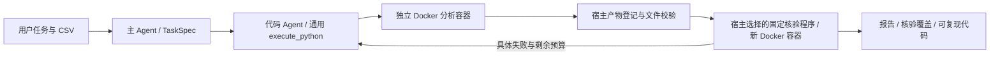

# 可靠分析与表格建模（开发中）

本轮基线为 `62bb7ad`。新增报告版本 3，版本 2 的历史继续可读；旧记录缺少新检查时显示未核验。首批120次未达到门槛，原结果保留；后续独立v2批次完成72次并达到数值门槛。发布还需代码回归、文件审查和远端CI，不能将开发用例通过等同于发布完成。

## 架构与边界



没有增加分类、回归等业务专用工具。分析算法仍由代码 Agent 编写；独立核验程序位于 `runtime/verification_program.py`，由宿主装入全新容器执行，不能由模型提交替代代码。无适用数值规则的普通分析保留原有执行路径，并明确标注未独立核验。

`TaskSpec` 保存目标、范围、假设、建模契约与可选成果数值关系；第一次有效计划后冻结，同一任务不能删除要求或改口径修复失败。新追问生成新的任务 ID、契约和计算证据。原始任务及确认回复也进入报告。结构化契约无法单独证明模型完整理解了用户意图。

稳定记录 ID `r000001...` 对应原 CSV 数据记录顺序，随输入 SHA-256 共同标识样本；不使用业务编号或 DataFrame 过滤后的行号。`load_dataset()` 仍返回字符串列 `c1...cN`，原始列名与记录 ID 分别位于 attrs 的 columns、record_ids；重复表头、前导零与 NA/NULL 不被改写。

重启后的历史背景只引用版本3当前成果对应、核验通过的完整代码；执行退出码为零但核验失败的尝试，以及已被修正替换的旧代码，留在原日志中，不列为成功背景。版本2历史保持兼容，缺少独立核验不被升级为已核验。历史背景不抵扣新任务的执行和成果要求。

## 建模成果协议

正式范围：普通独立样本、单 CSV、单目标的分类/回归，混合数值与类别特征。默认 seed 42、80/20；分类分层。缺失目标排除并记录，重复按约定处理。目标不明、分层不可行或时间/实体依赖时澄清。最多两个候选，选型只用训练部分内的验证数据。Pipeline/ColumnTransformer 只拟合训练数据，遵循 [scikit-learn 数据泄漏说明](https://scikit-learn.org/1.7/common_pitfalls.html)。

| 成果 | 必需内容 |
|---|---|
| 预测表 | source_record_id、y_true、y_pred、baseline_pred，完整测试集 |
| 元数据 | target、features、split、seed、test_size、duplicate_policy、train_ids、test_ids、excluded_ids、model、preprocessing；可选 validation_ids |
| 分类指标 | model/baseline 的 accuracy、macro_f1、labels、confusion_matrix、per_class（label、precision、recall、f1、support） |
| 回归指标 | model/baseline 的 mae、rmse、r2 |
| 图表、代码与报告 | 真实 PNG/SVG、对应绘图数据、完整脚本与执行记录 |

分类保留原始字符串标签，labels 为字典序；多数类同频按字典序。概览的 distinct_count 按全列非空原始字符串统计，不能以少量样例推断全部类别；它不合并数值格式不同的字符串。指标分母为零时为 null 并说明原因；macro-F1 对已定义类别取平均。回归测试样本不足两个或真实值恒定时 R²=null。元数据的 train_ids 包含整个训练部分，validation_ids 必须是其子集。

预测和指标成果保留计算精度，报告展示可以格式化。准确率核验采用绝对容差 1e-8，与冻结的独立评测一致；其他数值采用相对容差 1e-6、绝对容差 1e-8。开发案例曾把准确率提前四舍五入，使生产检查与评测不一致；现已收紧生产检查，没有放宽评测标准。

核验包括原始身份、拆分交集/覆盖、固定随机拆分复算、预测覆盖、真实标签、训练集基线与指标复算。通用关系支持结果表行数/和/均值/极值与登记指标对照。每项状态为 passed、failed、not_applicable、not_checked。文件检查不能证明图像中的视觉编码正确。生成代码可以读取全量快照，检查也不能证明训练全过程无泄漏或预测确实来自声明的估计器。

## 预算、复现与用量

沙箱镜像 `labweaver-python:0.3.0` 添加 scikit-learn 1.7.2 与带哈希的依赖锁；保留旧镜像用于旧记录重放。一般分析仍默认 60 秒，建模 120 秒，2 CPU、1 GiB、128 MiB 工作区不变。核验失败沿用每次委派三次执行的有限修正流程，不重置预算。宿主日志保留各次尝试，只有当前产物对应的检查进入最终覆盖。

计划提交允许首次尝试加两次参数修正，首次有效约定后立即冻结；主模型总上限仍为12次，代码执行预算没有随修正重置。新增记录模型接口真实 token 用量；缺失用量为 null，不估算费用。容器记录子进程 CPU 时间和峰值 RSS（不等同于整个容器峰值），失败/超限可能没有完整资源计量。

## 评测与开发状态

`evaluation/suite.json` 固定24题（8分析、8建模、8对话/RAG/异常，其中8题冻结）。基线48次、新版72次；每题三次。原始结果只存忽略目录。评测器第2版修正了把字典行误当列表比较的问题；基线使用原始字节重新评分，并保留旧评分字段，没有重新请求模型覆盖失败。

开发测试命令：

```powershell
uv run --frozen --extra web pytest -q -m "not docker"
docker build -t labweaver-python:0.3.0 sandbox
uv run --frozen --extra web pytest -q tests/test_modeling_docker.py
npm --prefix frontend test
npm --prefix frontend run build
python evaluation/run.py --source src --phase candidate --suite evaluation/suite-v2.json --output .cache/evaluation/candidate-v2 --image labweaver-python:0.3.0
```

首批实际结果见[评测汇总](../evaluation/results/initial.md)：基线共同任务31/48，新版32/48；新增建模9/24。核心M1/M2/M3分别1/3、2/3、0/3，因此不发布“正式建模已验收”的结论。初版实现指纹为 `b6cd4eee2a424806734166ca1ac0c282ecf5e24fd0be20368db7a89b6d873562`，后续修复不能归功于此前的72次结果。

非冻结任务暴露的实现问题包括：计划类型错误的反馈过于笼统、错误嵌套参数直接终止、第二次绘图委派核验看不到本任务建模成果，以及主 Agent 未收到核验摘要。修复分别采用具体错误位置/类型、原预算内有限修正、当前任务成果合并和核验收据传递，不改变模型算法或测试答案。开发回归另存独立目录，不覆盖正式失败。

后续开发又补充了连续回归不可按原始连续标签分层的前置约束（有明确分箱规则时使用 custom 并披露未核验范围），以及执行补全后最多一次单独的报告格式修正。两类反馈仍共享原模型/工具预算，格式修正不重新训练。第二批在发现契约问题后停止，25条已开始记录全部保留，其中一条由宿主主动取消；不能将其视为完整验收批次。新批次保存代码快照和指纹，防止开发过程中混入不同版本。

第三批完成17次后在任务之间停止，原始结果继续保留；第二、第三批均为部分批次，不作为完整发布验收。开发调试另存 development 目录，不能用其成功结果替换正式批次的失败。

经用户明确批准，新增 suite-v2.json，只将非冻结的 Ridge 回归题 M3 改为“80/20 随机拆分，不进行目标分层”。v1 与全部原结果保留，所有数值判据、8道冻结题、16道共同任务不变；自动测试验证两版只有此题措辞不同。v2 使用独立输出目录，同时冻结任务定义与代码。M3 的新旧结果不属于同题提升比较。其他排序或拆分措辞的歧义仍记录为评测限制，不能据少量达成率变化推断普遍能力提升。

v2最终结果为59/72：共同任务35/48（基线31/48），建模类24/24，M1/M2/M3各3/3。首次无需内部修正即达成9次，与基线相同；30次遇到执行或核验失败，其中28次最终修正达成。详见[v2完整结果](../evaluation/results/v2.md)。13次未达成全部保留；C1排序口径、C2检索引用、C3最终回答协议仍是明确弱点。没有根据这些结果修改冻结题或用重新运行覆盖失败。

累计保留254次记录：初版120次、两个停止批次42次、开发调试20次、v2正式72次。开发与部分批次不合并进正式成功率。v2固定Agent核心；批次开始后仅Web历史摘要筛选及前端特征展示有额外修复，未用于该批次的核心执行路径，分别由Web回归与浏览器检查验证。确切指纹和范围见[运行审计](../evaluation/results/run-audit.json)。

发布门槛仍为全量回归、真实浏览器与容器验收通过、共同任务达成率不低于基线、核心建模案例至少两次成功、已知错误不能核验通过。新统计基于小规模合成数据，不能外推为任意分析结论正确性保证；任意筛选后建模、时间/实体拆分及算法语义仍需额外审查。
